# midiTracker

midiTracker is an alternate firmware for the picoTracker v2 PCB. You can order your own [from xiphonics](https://xiphonics.com/products/picotracker-pcb-kit).

It plays MIDI files, tracker modules (MOD, S3M, XM and IT) and audio files (WAV, AIFF, MP3 and FLAC), records MIDI and SysEx to the SD card, and has a 4 track MIDI looper and a 16 channel multitimbral synth, pariSynth, that you can play over MIDI. It can also turn MIDI files, modules and audio files into WAVs.

Questions, bug reports or ideas go in #miditracker [on my discord](https://discord.gg/9Wun47jGC6), or open an issue here.

Enjoy!<br>
Dan

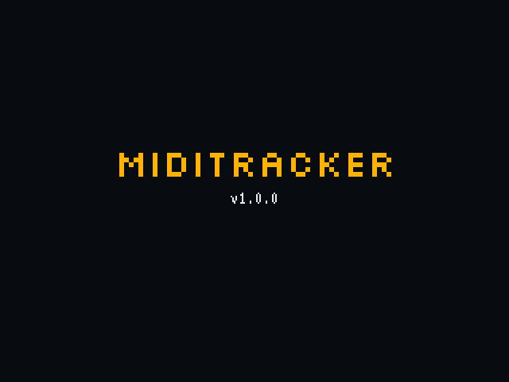

---

- [What you need](#what-you-need)
- [Installing](#installing)
- [The keys](#the-keys)
- [The screen](#the-screen)
- [The home screen](#the-home-screen)
- [Files](#files)
- [Playing files](#playing-files)
- [Locking the keys](#locking-the-keys)
- [Play modes and seeking](#play-modes-and-seeking)
- [Convert](#convert)
- [Recording MIDI](#recording-midi)
- [SysEx](#sysex)
- [The looper](#the-looper)
- [pariSynth](#parisynth)
- [Settings](#settings)
- [Themes](#themes)
- [The screensaver](#the-screensaver)
- [USB Drive](#usb-drive)
- [The battery](#the-battery)
- [The SD card](#the-sd-card)
- [Hardware](#hardware)
- [Building](#building)
- [Good to know](#good-to-know)
- [Credits](#credits)
- [Licence](#licence)

## What you need

- A picoTracker v2 PCB, or anything with the same RP2040 board and pins (see [Hardware](#hardware)).
- A micro SD card, FAT32 or exFAT.
- Headphones or a line input for the onboard synth and audio files, and a TRS MIDI cable or a USB cable for MIDI.

## Installing

1. Get `midiTracker-v1.0.0.uf2` from the [releases](https://github.com/roge-rm/midiTracker/releases).
2. Put the picoTracker in firmware update mode. If it's already running midiTracker, hold ENTER on **USB Bootloader** in Settings > MIDI/System. On the picoTracker firmware use its menu, or hold the boot button on the bottom while you plug in the USB cable.
3. It shows up on your computer as a drive called RPI-RP2. Copy the .uf2 file onto it and it restarts into midiTracker.

Updating is the same. Your settings, loops, banks and themes on the SD card stay as they are.

## The keys

```
      UP    PLAY   EDIT
LEFT  DOWN  RIGHT  ENTER
      ALT   NAV
```

- The arrows move around. RIGHT or ENTER goes into something and LEFT comes back out.
- PLAY plays, pauses and starts things. NAV stops, or goes back.
- EDIT and ALT are held to change what the arrows do. Holding EDIT and pressing LEFT or RIGHT changes a value on most screens.
- In a player, hold ALT and NAV together for a second to lock the keys, and the same again to unlock them.
- Lists wrap from the bottom back to the top.

Every screen has a footer that shows what the keys do there. Below, UD means UP or DOWN, LR means LEFT or RIGHT, and EDIT+LR means hold EDIT and press LEFT or RIGHT.

## The screen

- The strip along the top says which screen you're on. On the right are the MIDI IN and OUT lights and the battery.
- The footer at the bottom shows the keys for the screen you're on.
- Going into a screen and back out of it can wipe or slide, see Transitions in [Settings](#settings).

## The home screen

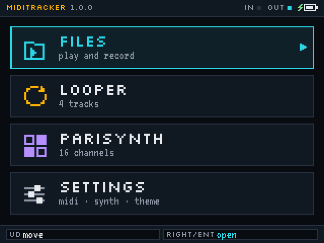

The home screen lists the four modes. UD picks one and RIGHT, ENTER or PLAY opens it. LEFT on a mode's first screen comes back here.

- **Files** plays and records files on the SD card.
- **Looper** is the 4 track MIDI looper.
- **pariSynth** is the onboard synth, played over MIDI.
- **Settings** has the audio, looper, metronome and MIDI/system settings.

## Files

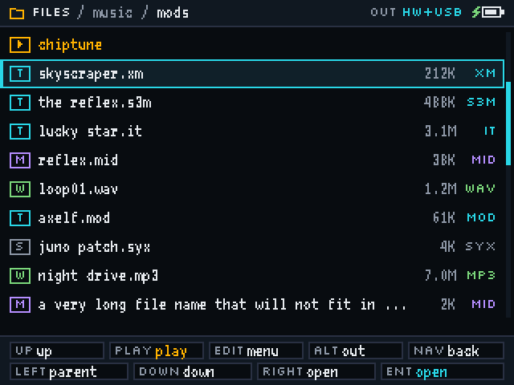

The browser shows folders and the files midiTracker can open, with the size and type of each. The top shows the path and where MIDI goes out (OUT HW, USB, HW+USB or Off).

| | |
|---|---|
| **UD** | move. Hold to scroll |
| **ALT+UD** | a page at a time |
| **RIGHT**, **ENTER** or **PLAY** | open a folder or play a file |
| **LEFT** or **NAV** | up a folder, and out to the home screen from the top |
| **ALT** | where MIDI goes out: HW, USB, HW+USB or Off |
| **EDIT** | the menu |

The menu has:

- **New Recording** and **Capture SysEx Dump**, which record into this folder. See [Recording MIDI](#recording-midi) and [SysEx](#sysex).
- **Load to Looper**, for a .mid. It asks which track and loads the file into it.
- **Open**, **Rename** and **Delete**.
- **Convert**, when the file can be turned into a WAV. See [Convert](#convert).
- **New Folder**.

Names are typed on an on-screen keyboard: the arrows move, ENTER types and NAV cancels. Long names and names with accents or other alphabets work, and a folder can hold a couple of thousand files. Folders over 512 entries are listed in the order they're on the card.

## Playing files

What it plays:

| Type | |
|---|---|
| **.mid** | type 0 and 1 MIDI files, out over TRS or USB MIDI and through the onboard synth |
| **.syx** | SysEx files, sent out over MIDI (see [SysEx](#sysex)) |
| **.mod**, **.s3m**, **.xm**, **.it** | tracker modules |
| **.wav** | 8, 16, 24 or 32-bit PCM, 32-bit float and IMA ADPCM, mono or stereo |
| **.aif**, **.aiff**, **.aifc** | AIFF and AIFF-C |
| **.mp3** | MPEG 1, 2 and 2.5 layer III, CBR or VBR |
| **.flac** | 4 to 24 bits, mono or stereo, up to 192 kHz |

Audio at other sample rates is resampled to 44.1 kHz, and 24 and 32-bit files play at 16 bits.

### MIDI files

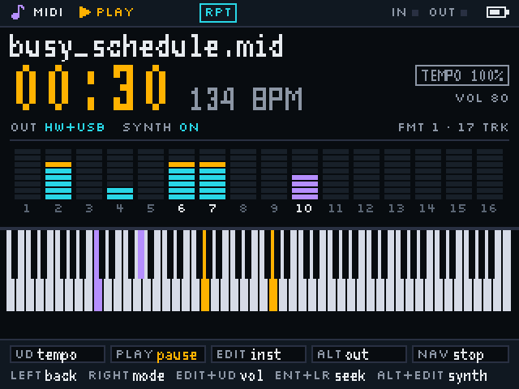

The screen shows the time, tempo and file type, a meter for each of the 16 channels and a keyboard that lights up with the notes. Channel 10 (drums) is purple.

| | |
|---|---|
| **PLAY** | pause and play |
| **NAV** | stop. PLAY starts it again from the top |
| **UD** | tempo, in 5% steps |
| **EDIT+UD** | volume |
| **ENTER+LR** | seek. Hold for faster |
| **RIGHT** | play mode (see below) |
| **ALT** | where MIDI goes out: HW, USB, HW+USB or Off |
| **ALT+EDIT** | the onboard synth on and off |
| **EDIT** | the pariSynth grid, to change the instruments while it plays |
| **LEFT** | back to the browser |
| **ALT+NAV** | hold to lock the keys (see [Locking the keys](#locking-the-keys)) |

The onboard synth plays 24 notes and 8 drums at once. It sounds very chiptuney, which is part of the fun, and you can change its sounds in [pariSynth](#parisynth).

### Tracker modules

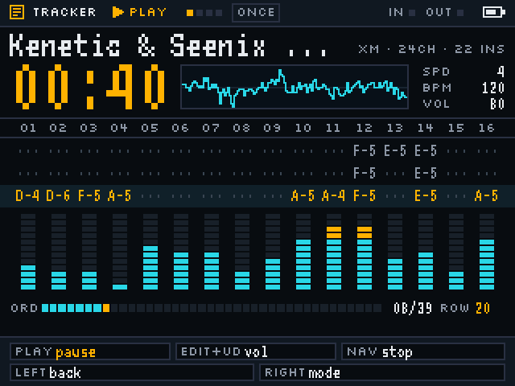

The screen shows the song, time, speed and BPM, a scope, the notes on the pattern row and a meter for each channel, and where you are in the song's order list.

| | |
|---|---|
| **PLAY** | pause and play |
| **NAV** | stop |
| **EDIT+UD** | volume |
| **RIGHT** | play mode |
| **LEFT** | back to the browser |
| **ALT+NAV** | hold to lock the keys (see [Locking the keys](#locking-the-keys)) |

They're played to sound as close as I could get to OpenMPT. Volume changes, cuts and new notes are ramped so they don't click.

- .it files play in sample or instrument mode, with envelopes, new note actions, resonant filters and up to 32 notes at once. Stereo samples are mixed to mono.
- The first time you open a .it with compressed samples it unpacks them into a hidden `/.itcache` folder on the card, which can take a few seconds. The card needs to be writable with some free space. The last 4 files stay there and open straight away after that.
- Very busy files may slow down.

Modules, MP3s and FLACs use the same RAM as the looper's tracks. If the looper has loops you haven't saved, it asks first: **Save & Continue**, **Discard & Continue** or **Cancel**.

### Audio files

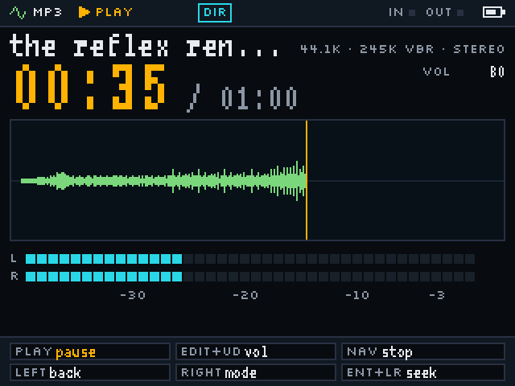

WAV, AIFF, MP3 and FLAC show the time and length, the format, the waveform so far and L and R meters.

| | |
|---|---|
| **PLAY** | pause and play |
| **NAV** | stop |
| **EDIT+UD** | volume |
| **ENTER+LR** | seek. Hold for faster |
| **RIGHT** | play mode |
| **LEFT** | back to the browser |
| **ALT+NAV** | hold to lock the keys (see [Locking the keys](#locking-the-keys)) |

## Locking the keys

Hold ALT and NAV together for a second on any player screen to lock the keys. A lock shows at the top. While locked no key does anything, and a press shows "Locked, hold ALT+NAV". Hold ALT and NAV again for a second to unlock.

The lock stays on through the screensaver and when Repeat or Folder moves to the next file. It goes off when you leave the player or a file can't play, and it isn't saved.

## Play modes and seeking

RIGHT in any player cycles what happens when a file ends. The mode shows at the top of the player.

- **Once** (ONCE) stops at the end.
- **Repeat** (RPT) plays the file again.
- **Folder** (DIR) plays the next file in the same folder, and goes back to the first one after the last. SysEx files are skipped.

The play mode you start with is **Default Play Mode** in Settings > Audio.

To seek, hold ENTER and press or hold LEFT or RIGHT. It works in MIDI files and audio files. A MIDI file catches up on the instruments, controllers and tempo at the new spot, so it sounds right from there.

## Convert

| | |
|---|---|
| 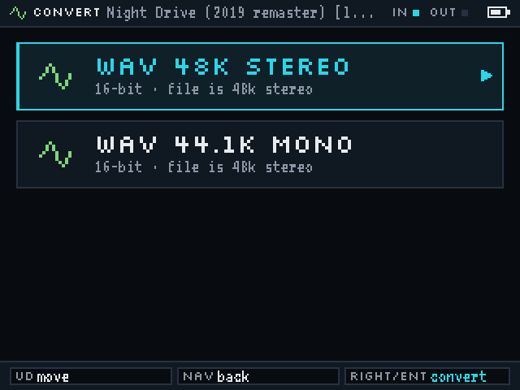<br>Picking what to make | 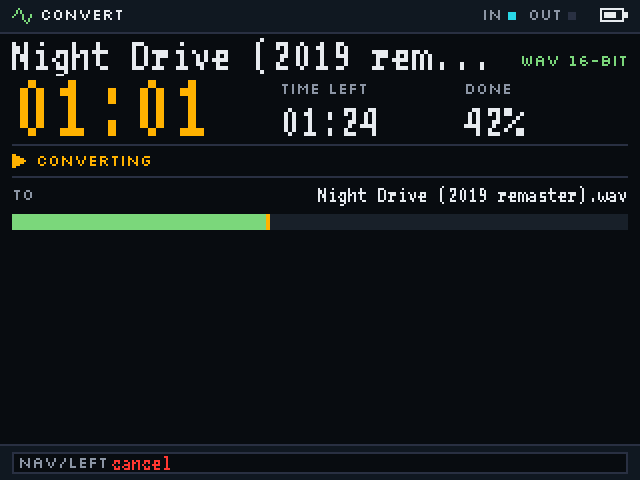<br>Converting |

Pick a file in the browser, press EDIT and choose **Convert**. It lists only what that file can become:

- **MP3**: a 16-bit WAV at the MP3's own rate, or 44.1 kHz mono.
- **WAV**, **AIFF** and **FLAC**: a 16-bit 44.1 kHz WAV, stereo or mono.
- **MIDI files**: a 44.1 kHz WAV, stereo or mono, played through the onboard synth.
- **Modules**: a 44.1 kHz WAV, stereo or mono, played through the tracker player until the song ends.

UD picks, RIGHT or ENTER starts. The screen shows how far along it is and the time left, and NAV or LEFT cancels. The WAV goes in the same folder with the same name. If that name is taken it gets a free one, so nothing is overwritten. If you cancel or the card fills up, the half-made file is deleted.

## Recording MIDI

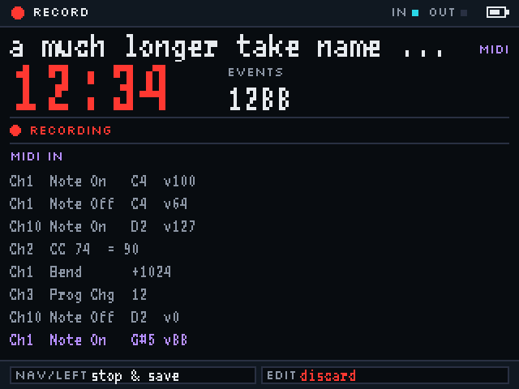

1. In the browser, go to the folder you want and press EDIT, then **New Recording**.
2. The name starts as the next free REC###. Change it if you like and confirm.
3. Play. Recording starts with the first message in, from TRS or USB MIDI.
4. NAV or LEFT stops and saves the .mid (type 0).

Notes, CCs, pitch bend, program changes and SysEx are all recorded as they come in, and the screen lists them as they arrive. There's no set length limit.

EDIT discards the take. It asks first: ENTER or PLAY discards and NAV keeps going.

If you record over a file that's already there, the old one stays until the new take is saved. If the card fills up or a write fails, what was recorded is kept as a playable file under the next free name.

## SysEx

### Capturing a dump

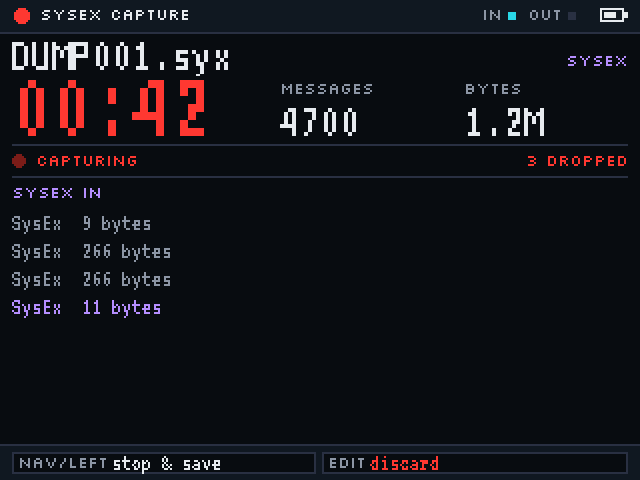

Use this to back up patches, banks and settings from a synth.

1. In the browser, press EDIT and choose **Capture SysEx Dump**.
2. The name starts as the next free DUMP###. Confirm it.
3. Start the dump on the synth. Messages come in from TRS or USB MIDI.
4. NAV or LEFT stops and saves the .syx.

Messages of any length are captured. Everything other than SysEx is ignored.

### Sending a dump

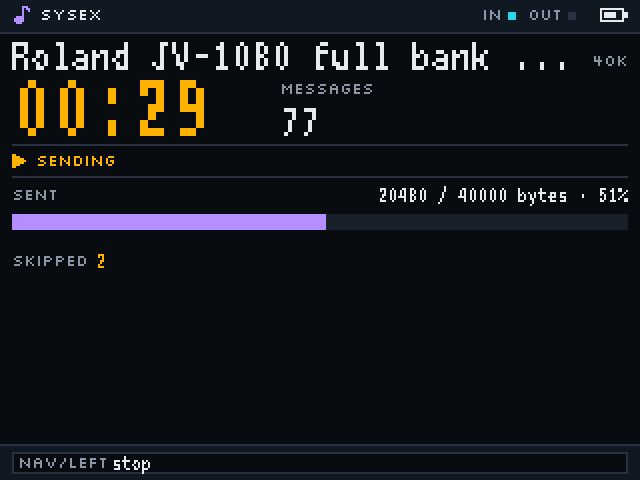

Open a .syx in the browser and it's sent out over MIDI, at a pace a hardware synth can keep up with. The screen shows how much has gone out. Broken or cut-off messages in the file are skipped and counted. NAV or LEFT stops.

## The looper

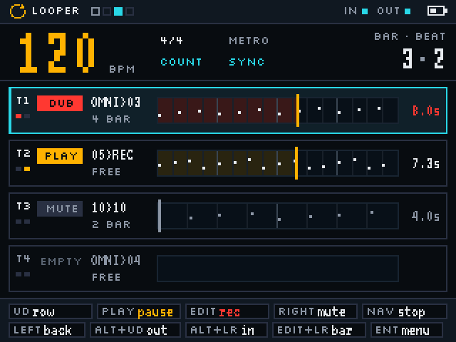

The looper has 4 tracks of MIDI. The top row is the tempo, time signature, metronome, count in, sync, and the bar and beat. Under it is a row for each track with its state, its MIDI channels, its length in bars (or FREE) and a lane with the notes and a playhead.

### A track row

| | |
|---|---|
| **UD** | pick a track, or the top row |
| **EDIT** | arm the track to record. It starts with the first note. Press again to close the loop and play it |
| **EDIT** on a playing track | overdub. Press again to stop overdubbing |
| **EDIT**, held | start every stopped track |
| **PLAY** | pause and resume the track |
| **RIGHT** | mute the track |
| **NAV** | stop the track. Hold it to stop all of them |
| **ALT+LR** | the input channel: OMNI or 1-16 |
| **ALT+UD** | the output channel: REC (the channel each note was played on) or 1-16 |
| **EDIT+LR** | the loop length: free or a number of bars |
| **ENTER+PLAY** | erase the track |
| **ENTER** | the menu |
| **LEFT** | back to the home screen. If loops are playing it asks first |

A free track's loop is as long as you played it. A track set to bars closes its loop at the end of that many bars and stretches with the tempo.

### The top row

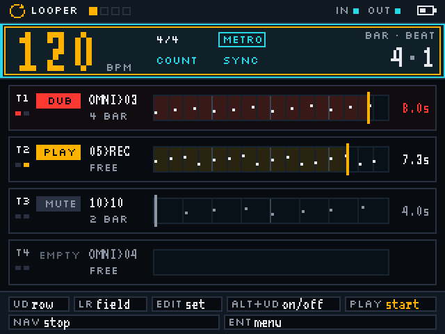

On the top row, LR moves between the tempo, time signature, METRO, COUNT and SYNC.

- On the tempo, EDIT+UD changes it by 10 and EDIT+LR by 1.
- On the time signature, hold EDIT and use the arrows.
- On METRO, COUNT and SYNC, a tap of EDIT or ALT+UD turns them on and off.
- On METRO, EDIT+LR sets the click volume. On COUNT, hold EDIT and use the arrows to set the count-in bars.
- PLAY starts the count in (or just the click), and starts every stopped track.

With SYNC on the tracks share a start point and stay in time with each other. With it off each track runs on its own.

The tempo can come from the looper or from MIDI clock, and the looper can follow MIDI Start, Stop and Continue. Both are in Settings > MIDI/System.

### The menu

ENTER opens:

- **Save**: save the selected loop as a .mid in `/loops`, or all 4 tracks as a bundle in `/loops/bundles`. A bundle keeps the tempo, time signature and sync too.
- **Load**: a loop or a bundle, or one track out of a bundle into the selected track.
- **Erase Track N** and **Erase All Tracks**.
- **Delete Loop Bundle**.

You can also load any .mid into a track from the browser with **Load to Looper**. Every track and channel in the file goes into the one track, so you can loop your favourite Rick Astley MIDI file and play along.

A track holds up to 4144 events and about 37 minutes. Loops live in RAM until you save them.

## pariSynth

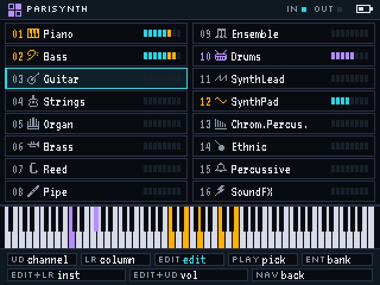

pariSynth is the onboard synth, played over TRS or USB MIDI on all 16 channels at once. Each channel has an instrument family, picked by the program changes it gets or by hand. Channel 10 is the drum kit. The cells light up with what each channel is playing and the keyboard shows the notes.

| | |
|---|---|
| **UD** | pick a channel |
| **LR** | jump between the two columns |
| **EDIT+LR** | the channel's instrument |
| **EDIT+UD** | volume |
| **PLAY** | a list of all the instruments to pick from |
| **EDIT** | edit the channel's instrument |
| **ENTER** | the bank menu |
| **NAV** | back to the home screen |

The same grid comes up with EDIT while a MIDI file plays, so you can change its sounds as it goes.

### Editing an instrument

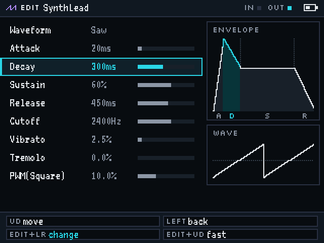

Each instrument has a waveform (sine, triangle, saw, square or noise), an envelope, a cutoff, vibrato, tremolo and pulse width. The drums have their own settings, like a pitch drop. UD picks a row, EDIT+LR changes it and EDIT+UD changes it faster. A tap of EDIT steps the waveform. The envelope and wave boxes show what you've set.

Changes apply straight away, to pariSynth and to MIDI files played through the synth.

### Banks

ENTER on the grid opens **Save Bank**, **Load Bank** and **Reset to Default**. Banks are saved as .syn files in `/synth`, and the one you're using is loaded again at start.

## Settings

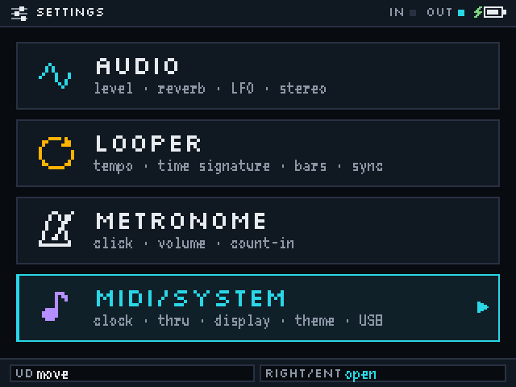

Settings has four pages. UD picks one and RIGHT or ENTER opens it. On a page, UD moves, EDIT+LR changes a setting and a tap of EDIT steps it to the next choice. LEFT goes back to the list. Settings are saved to the card when you leave and loaded at start.

| | |
|---|---|
| 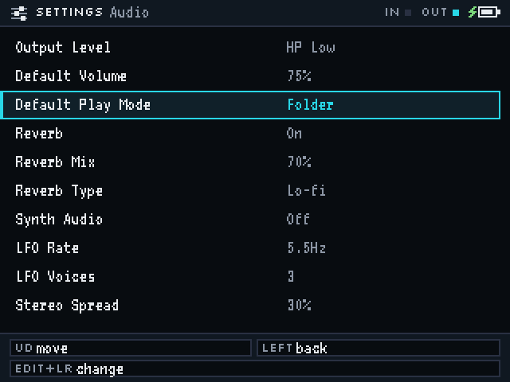<br>Audio | 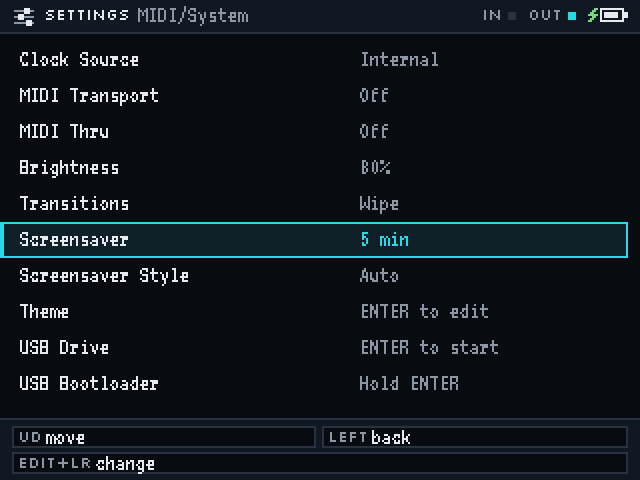<br>MIDI/System |

**Audio**

- **Output Level**: HP Low, HP High or Line Level, to match what you've plugged in.
- **Default Volume** and **Default Play Mode**: what the players start with.
- **Reverb**, **Reverb Mix** and **Reverb Type** (Lo-fi, Lush or Shimmer), on the synth.
- **Synth Audio**: the onboard synth on or off.
- **LFO Rate**: the speed of the vibrato, tremolo and PWM, or Off.
- **LFO Voices**: how many notes can wobble at once.
- **Stereo Spread**: how wide the synth's channels are spread.

**Looper**

- **Default BPM**, **Time Sig**, **Loop Length** and **Sync Mode**: what the looper starts with.

**Metronome**

- **Metronome**, **Metro Volume**, **Count In** and **Count In Bars**.

**MIDI/System**

- **Clock Source**: Internal, or External to follow MIDI clock.
- **MIDI Transport**: follow MIDI Start, Stop and Continue.
- **MIDI Thru**: Off, On, or one way only (TRS>USB, USB>TRS, TRS>TRS, USB>USB).
- **Brightness**.
- **Transitions**: Off, Wipe or Slide, when you go into a screen and back out.
- **Screensaver** and **Screensaver Style**, see [The screensaver](#the-screensaver).
- **Theme**: ENTER opens the theme editor, see [Themes](#themes).
- **USB Drive**: ENTER shows the card to your computer, see [USB Drive](#usb-drive).
- **USB Bootloader**: hold ENTER to restart into firmware update mode.

## Themes

The theme editor changes the colours, one row for each of 24 parts of the screen: the background, text, selection, the looper's track states, the beat, the note colours and so on. UD picks a row, LR picks R, G or B and EDIT+UD or EDIT+LR changes it.

ENTER opens **Save Theme**, **Load Theme** and **Reset to Default**. Themes are saved as .thm files in `/themes`, and the one you chose is loaded again at start.

## The screensaver

After a while with no keys pressed the screen dims and shows one of these. Any key wakes it up. The backlight goes off later on, after 5 minutes if something is playing and 1 minute if not.

| | |
|---|---|
| 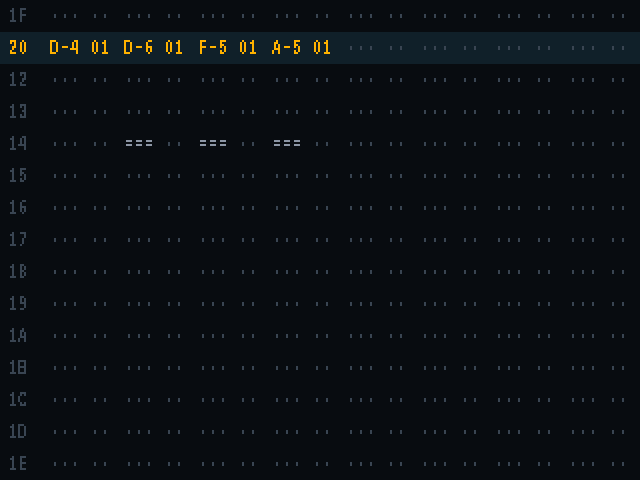<br>Pattern rain, for modules and MIDI files | 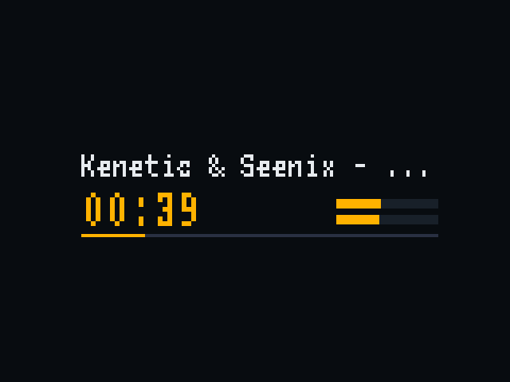<br>Now playing |
| 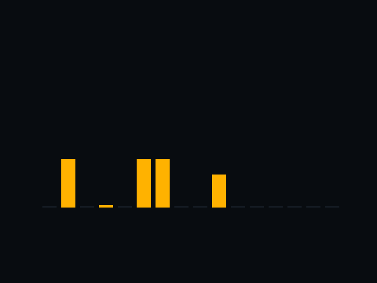<br>Meters | 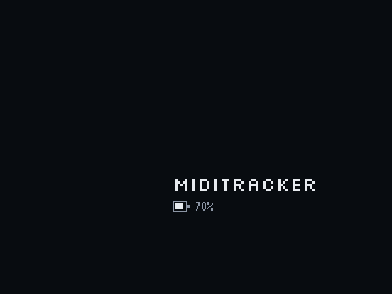<br>Nothing playing |

**Screensaver** in Settings > MIDI/System sets the time (1, 2, 5 or 10 minutes) or turns it off. **Screensaver Style** picks the view: Auto (pattern rain for modules and MIDI files, now playing for the rest), Now playing, Meters or Black.

## USB Drive

Press ENTER on **USB Drive** in Settings > MIDI/System and the SD card shows up on your computer as a drive, so you can copy files on and off without taking the card out. USB MIDI keeps working.

To give the card back to midiTracker, eject the drive on the computer or press LEFT. Eject first if you've copied anything, since LEFT doesn't wait for the computer to finish writing. Unplugging the cable gives it back too.

Use Eject, and avoid Power Off (GNOME and other Linux desktops) and Safely Remove Hardware (Windows). Those turn off the whole USB device, MIDI included, until you unplug it and plug it back in.

If the card can't be read at start, for example after it was formatted on a computer, midiTracker offers it as a drive so you can fix it, and carries on once it reads again.

## The battery

The battery shows in the top right of every screen. It turns red under 15%. A green bolt shows while it's plugged into a computer. A plain USB charger charges it but doesn't show the bolt.

## The SD card

Put your files anywhere you like on the card. midiTracker keeps its own things here:

| | |
|---|---|
| `/settings.txt` | your settings |
| `/parisynth.txt` | the pariSynth sounds you're using |
| `/synth` | saved pariSynth banks (.syn) |
| `/themes` | saved themes (.thm) |
| `/loops` | saved loops (.mid) |
| `/loops/bundles` | saved looper sessions, a folder each |
| `/.itcache` | unpacked .it samples, safe to delete |

Recordings, SysEx dumps and converted files go in whichever folder you're in.

## Hardware

- RP2040 (Raspberry Pi Pico), run at 200 MHz.
- 240x320 ST7789 display on SPI1.
- SD card over 4-bit SDIO.
- MIDI on a 3.5 mm TRS jack (UART0) and over USB, both at once.
- An I2S DAC for the synth and audio.
- 9 keys to ground, with the internal pull-ups.
- The battery voltage through a 2:1 divider.

| Pin | |
|---|---|
| GP0, GP1 | MIDI out, MIDI in |
| GP2, GP3 | SD clock, command |
| GP4-GP7 | SD data 0-3 |
| GP8, GP9, GP10, GP11 | LEFT, DOWN, RIGHT, UP |
| GP12, GP13, GP14, GP15, GP16 | ALT, EDIT, ENTER, NAV, PLAY |
| GP17, GP18, GP19 | I2S data, bit clock, word clock |
| GP20, GP21, GP22 | display CS, DC, reset |
| GP23 | display backlight |
| GP26, GP27, GP28 | display SCK, MOSI, MISO |
| GP29 | battery |

The pins are in `include/pins.h` and the display settings in `platformio.ini`.

## Building

midiTracker builds with [PlatformIO](https://platformio.org/), which fetches the RP2040 core and the libraries for you.

```
pio run -e pico
```

The firmware is `.pio/build/pico/firmware.uf2`. Copy it to the picoTracker in firmware update mode, or flash it with `pio run -e pico -t upload`.

The `pico_profile*` environments are test builds that print timings over USB serial. `test/host` has tests and renders that run on a computer, including the screenshots in this README (`make -C test/host look` and `make -C test/host players`).

## Good to know

- A MIDI file can have up to 64 tracks.
- External clock follows the tempo, but loops aren't locked to the incoming clock pulse by pulse.
- Now and then a busy module can stall reading the card for a moment, heard as a short slowdown or crackle.
- MOD, S3M, XM and IT playback sounds close to OpenMPT on most files I've tried, but not on all of them.

## Credits

The picoTracker hardware is by xiphonics.

MP3 files are decoded with the Helix fixed-point MP3 decoder by RealNetworks, under the RealNetworks Public Source License 1.0 (RPSL). I've changed it to run faster on the RP2040 and to use no heap. The source of the decoder as used here, changes included, is available in this repository in [lib/helix_mp3](lib/helix_mp3), under the RPSL (see [RPSL.txt](lib/helix_mp3/RPSL.txt) and [VENDORED.txt](lib/helix_mp3/VENDORED.txt) for where it came from and what changed). It's also packaged on its own as helix-mp3-pico, at [github.com/roge-rm/helix-mp3-pico](https://github.com/roge-rm/helix-mp3-pico). This is my port, not an official Helix release.

FLAC files are decoded with [dr_flac](https://github.com/mackron/dr_libs) by David Reid, public domain or MIT-0, in [lib/dr_flac](lib/dr_flac) with one small change (see [VENDORED.txt](lib/dr_flac/VENDORED.txt)).

The screen uses the [Silkscreen](https://github.com/googlefonts/silkscreen) and VT323 fonts, both under the SIL Open Font License 1.1 (see [include/fonts](include/fonts)).

It's built on the [arduino-pico](https://github.com/earlephilhower/arduino-pico) core by Earle F. Philhower, with [TFT_eSPI](https://github.com/Bodmer/TFT_eSPI) by Bodmer, [SdFat](https://github.com/greiman/SdFat) by Bill Greiman, the [Arduino MIDI Library](https://github.com/FortySevenEffects/arduino_midi_library) by FortySevenEffects and the [Adafruit TinyUSB Library](https://github.com/adafruit/Adafruit_TinyUSB_Arduino).

The tracker players are my own, checked against [OpenMPT](https://openmpt.org/)'s openmpt123 to sound like it.

## Licence

midiTracker is under the MIT licence (see [LICENSE](LICENSE)). The Helix MP3 decoder in lib/helix_mp3 stays under the RPSL 1.0, dr_flac under its own licence and the fonts under the SIL Open Font License, as above.
